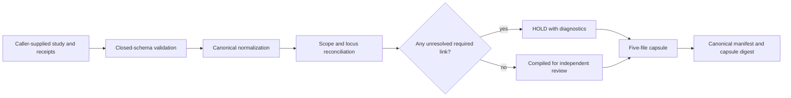

# Architecture

PhytoLocus is a deterministic compiler. It accepts a closed study document, reconciles declared
evidence without inventing missing links, and writes an exact-set capsule for independent review.
The core performs no discovery and has no implicit network access.

## Data flow

Validation errors refuse malformed documents. Scientifically incomplete but structurally valid
documents remain representable as `HOLD`; this distinction prevents schema compliance from being
mistaken for evidence sufficiency.

## Components

### Input boundary

The input layer parses JSON, rejects unknown fields, bounds collections and text, and verifies that
declared identifiers, digests, versions, coordinates, and relationships are well formed. Syntax is
not authority: a syntactically valid `SAMPLE` material identifier is still only a caller claim
unless its source and content bindings are independently supported.

### Normalization

Normalization converts equivalent JSON representations into one canonical internal form. Lists
whose order has meaning retain it; set-like lists are normalized according to their schema. Unicode,
numbers, coordinates, and digests are handled explicitly. No environment path, clock value, random
identifier, network response, or host detail enters deterministic output.

### Reconciliation

The reconciliation engine evaluates technical joins across these independent scopes:

- caller-declared species text and material parent/origin components;
- assembly identifiers, releases, phasing/completeness labels, and represented material;
- content-addressed genomic, transcript, CDS, and protein sequence objects with source
  record/version labels;
- one-based closed locus intervals and transcript-model references;
- typed observations and endpoint-constrained correspondence claims;
- receipt subject bindings and closed local-artifact, ToolUniverse-call, or declaration provenance
  envelopes.

v0.1 has no semantic entities for experiments, sequencing runs, files, variants or structural
variants, tissues, stages, assays, or conditions. An artifact or source response concerning any of
those concepts can be bound only as byte/provenance evidence; PhytoLocus does not parse it into an
entity or reconcile its biological scope. Observation kinds such as `PHASE`, `ALIGNMENT`, or
`COPY_NUMBER` commit a typed result against existing graph objects; they do not create a variant,
alignment-file, or experiment model.

A join is retained only when the relevant scopes agree. Conflicts are emitted as diagnostics rather
than resolved by source preference or majority vote. Evidence absence is not inferred when source
pagination, query scope, or denominator completeness is unproven.

### Capsule writer

The writer uses canonical UTF-8 JSON with sorted object keys, no NaN or infinity, compact separators,
and one trailing newline. It exclusively creates the caller's final directory, holds the parent and
capsule directory descriptors throughout the operation, writes the manifest last, and verifies the
exact member set before returning. A failed build may therefore leave an incomplete, invalid final
directory for inspection or explicit removal; it is not an atomic rename-based publication.
Symbolic links, hard-linked members, special files, and extra members are invalid.

Compilation and validation own descriptor-bound byte snapshots, not the future state of a mutable
filesystem path. Each returned capsule report therefore says
`validation_subject: "OWNED_BYTE_SNAPSHOT"`, `snapshot_valid: true`, and
`mutable_path_current_at_return_guaranteed: false`. `capsule_valid: true` is retained for API
compatibility and means that owned snapshot passed the requested checks. It does not promise that a
same-user concurrent writer left the directory unchanged after any last observation or at return.
Callers that need later assurance must validate again and retain the reported digest through an
independent channel. No filesystem implementation can atomically prove a mutable path's future
contents to a caller after returning.

The v0.1 capsule filesystem API is intentionally limited to POSIX systems with descriptor-relative
`open`, `stat`, and `mkdir` plus descriptor-based directory listing (tested on Linux and macOS).
It fails closed on platforms without those primitives. The in-memory model and compiler remain
platform-independent; this narrow claim avoids implying untested Windows race resistance.

The five files are:

- `study_lock.json`: normalized input and commitments used for compilation;
- `reconciliation.json`: technical joins, conflicts, unresolved claims, and overall state;
- `pec_candidate_evidence.json`: candidate evidence for an independent evidence judge;
- `phytoresolve_proposed_events.json`: append proposals for a separate persistent-memory owner;
- `manifest.json`: byte size and SHA-256 commitments for the other files plus capsule metadata.

The two integration exports cannot broaden the reconciliation result. They contain candidate or
proposed information only and never constitute a direct gate closure or memory write.

### Validators

Three validation modes answer different questions:

- Manifest validation checks the owned snapshot's exact members, canonical bytes, sizes, internal
  hashes, closed nested authority fields, and deterministic recompilation from the embedded
  normalized study.
- `--study` validation recompiles from the original study and requires semantic identity.
- `--expected-digest` compares the capsule commitment with a digest retained elsewhere.

None authenticates a physical specimen or the truth of caller-supplied claims.

## Failure model

PhytoLocus distinguishes:

- **invalid**: malformed or contradictory input that cannot be compiled safely;
- **hold**: valid representation with one or more unresolved required links;
- **compiled for independent review**: all compiler-defined technical prerequisites are present.

The last state is deliberately not named PASS. Independent scientific, legal, biosafety, and
laboratory review remains outside the system.

## Extension boundaries

Source adapters and ToolUniverse wrappers sit outside the deterministic core. They may retrieve
public metadata, but the v0.1 bridge retains only a closed provenance envelope containing response
and argument commitments, retrieval time, endpoint/version labels, and collection coverage. The
compiler consumes that receipt; it neither imports an upstream entity model nor trusts the adapter
merely because it is installed.
