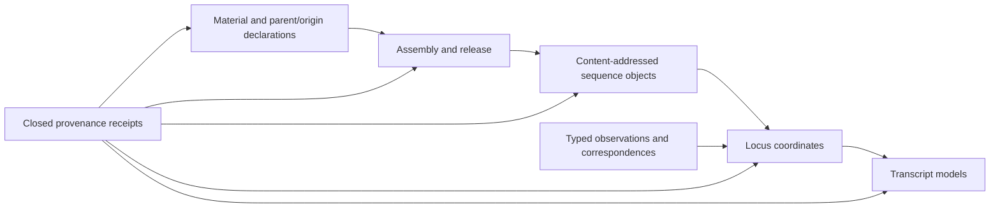

# Provenance model

PhytoLocus treats provenance as a chain of scoped claims, not a single `source` string. Each link can
be present, content-bound, independently authenticated, conflicting, or unresolved.

## Evidence chain

Every edge is a declared, technically checked graph relationship. Database records can document a
claim, but they cannot by themselves verify that the material in hand is the same plant or stock.
Qualified chain-of-custody and laboratory controls remain external.

v0.1 has no semantic entities for experiments, sequencing runs, files, variants or structural
variants, tissues, stages, assays, or conditions. An artifact or source response concerning any of
those concepts can be bound only as byte/provenance evidence; PhytoLocus does not parse it into an
entity or reconcile its biological scope.

## Claim layers

- A **declaration** says what the caller believes a record represents.
- A **source receipt** records where and how a claim was obtained.
- A **content binding** records exact bytes, size, and digest when available.
- A **relationship receipt** binds a typed correspondence claim between existing v0.1 graph
  objects, such as a transcript model to its locus model.
- **Independent authentication** is an external adjudication and cannot be self-issued by the
  compiler.

These layers must remain distinguishable in inputs and outputs. A checksum downloaded beside a file
is useful for transfer integrity but is not automatically independent. A source that repeats a
submitter's claim does not create an independent biological replicate.

## Inline provenance envelope

Receipts keep two independent bindings. `subject_sha256` commits the canonical graph-object subject
(not adapter arguments), while `artifact_sha256` commits the canonical closed provenance envelope
when one is present. That envelope retains capture method, content digest, source record and
release, tool and version, capture time, collection coverage, and artifact format/coordinate/
reference/checksum semantics. Reconciliation copies it into `receipt_bindings` with
`provenance_envelope_bound: true`.

Raw legacy or manual receipts may omit `provenance`; the model normalizes that omission to `null`.
Such a receipt is a declaration only. A technical verification label cannot recover metadata that
was never captured or turn the declaration into external authority.

## Source-adapter receipts

A v0.1 `TOOLUNIVERSE_CALL` envelope retains only the tool name and installed version, canonical
argument digest, canonical response digest, calendar-valid retrieval timestamp, source record and
optional release labels, and an optional seven-field collection audit. The normalized receipt does
not retain raw arguments, raw responses, returned records, URLs, or an upstream experiment/run/file/
variant schema. If reported collection coverage cannot be proven complete, the audit preserves that
state rather than converting it into completeness.
The exact canonical request and response snapshots are each bounded to 100 MiB and 128 JSON
nesting levels before their digests are accepted. These deterministic limits avoid
interpreter-dependent recursion behavior and resource exhaustion.

Local-artifact projections are also type constrained: annotation files can support annotation or
source receipts; assembly/graph sequence files can support assembly, sequence, or source receipts;
transcript FASTA can support sequence or source receipts; and BAM, CRAM, PAF, VCF, or BCF can support
observation or source receipts. BAM and CRAM require both a coordinate convention and reference.
The adapter refuses unrelated projections instead of relabeling bytes. The closed core receipt
model independently repeats this artifact-kind-to-receipt-kind check, so direct API callers cannot
bypass it. Likewise, a `TOOLUNIVERSE_CALL` provenance envelope can bind only a `SOURCE` receipt; it
cannot be projected directly as material, assembly, annotation, sequence, observation, or
correspondence authority.

These projection names constrain provenance only. A VCF/BCF receipt does not create variant or
structural-variant entities; a BAM/CRAM/PAF receipt does not create a run, file, alignment, tissue,
assay, or condition entity; and a GFF/GTF receipt does not import a general annotation graph.

Path-based JSON and local-artifact capture own one descriptor-bound read. Before and after reading,
the implementation checks device, inode, byte size, modification time, status-change time, and link
count, and compares the final named path identity. A detected rewrite, replacement, or new hard link
is rejected. This is a race-resistance boundary for the bytes read, not a guarantee that a mutable
path remains unchanged after the function returns.

## Persistent memory

PhytoLocus is stateless. A study may bind an immutable ledger head owned by a separate
persistent-memory system. The capsule can emit proposed events against that head, but cannot append
them. The receiving system must validate the proposal, require the exact expected head, and refuse a
silent rebase. A proposal does not become historical fact merely because its JSON is valid.

## Reporting

Methods and data-availability text should record:

- PhytoLocus version;
- schema/compiler version;
- exact study and capsule digest retained through an independent channel;
- assembly identifier/release and sequence source-record/version labels;
- unresolved holds and scope limitations;
- which authorities, if any, authenticated source and stock claims.

Do not describe a valid capsule snapshot as proof of function, genotype, stock identity, experiment
readiness, or the later state of its mutable directory path.
